# How shocks travel across US markets, 2003-2026

Contagion Lab research report. Data through 2026-11-12; built 2026-11-14.

Claim levels:

- **Descriptive.** Descriptive co-movement: no direction, no mechanism.
- **Predictive.** Predictive (lead-lag) content: direction in time only; not evidence of causation.
- **Identified.** Causal effect under stated identifying assumptions; invalid if the assumptions fail.

## Answers

- **Q1. Does cross-asset connectedness increase before crises?** No, not reliably. Rolling-VAR connectedness rose over the year before 3 of 7 bear-market peaks (placebo p = 0.47; TVP-VAR p = 0.26). The smallest of the 14 pre-peak p-values is 0.04 (TCI rolling 250d, 63-day window), and after Benjamini-Hochberg correction the smallest q-value is 0.36: a hint of a rise in the last three months, not evidence of a systematic build-up. Connectedness does rise with the crisis itself: over the 63 days after the peak TCI rolling 250d (+1.53, p = 0.02), Dynamic TCI 500d (+0.31, p = 0.00), Absorption 250d (+0.01, p = 0.01). It is a volatility-state variable: alone it predicts next-quarter volatility (Newey-West t 2.9 to 3.3), but once today's realized volatility and VIX are controlled for, the t-statistics fall to 0.1 to 1.0. Out of sample, adding connectedness to a VIX / realized-vol / momentum model does not improve the prediction of a >=10% fall within three months (AUC 0.55 -> 0.42; difference 90% interval -0.29 to +0.03).
- **Q2. Which assets act as shock transmitters?** In the standard Diebold-Yilmaz sense the transmitters are equities: EFA, SPY, EEM, IWM have the largest NET (+16 to +30 points) and are net transmitters in 94-100% of rolling windows. But 90% of the equity NET comes from same-day correlation, which is symmetric and only says these assets are central. Lagged spillovers carry the directional (predictive) content, and they are small: 2.6% of total connectedness in the macro network and 1.4% in the synchronous one. Their direction tracks how late each series absorbs equity news (Spearman -0.46 between that lag and lagged NET; the close hour alone gives 0.01 because it misses stale marks), and with synchronous prices no asset's lagged NET exceeds 1.9 points. In the tails, VIX, SPY, IWM have the largest Delta-CoVaR out-strength (descriptive). Which asset 'transmits' therefore depends on the definition, and none of these measures identifies a causal transmitter.
- **Q3. Which sectors are most vulnerable to rate shocks?** On the descriptive evidence, XLRE Real estate (XLRE), ITB Homebuilders, IYR Real estate, XLU Utilities have the most negative rate betas holding the market fixed, and the lowest betas in the positive stock-bond-correlation (inflation) regime are ITB Homebuilders, XLRE Real estate (XLRE), IYR Real estate. At the other end, XLF Financials, XLE Energy, KRE Regional banks gain relative to the market when yields rise. The causal question, what a policy-driven rate rise does, is answered for the market as a whole but only coarsely by sector. FOMC days raise the variance of the 2Y yield 2.0x relative to control days (90% CI 1.6-2.5; 1.9x outside the zero lower bound). That is enough to identify the S&P 500's response, -0.98% per +10bp policy-driven 2Y move (90% CI -2.07 to -0.33), but only 3 of 18 sector responses relative to the market have a 90% interval excluding zero (Discretionary -0.48%, Comm. services -0.32%, Growth (R1000G) -0.18%). The point estimates rank ITB Homebuilders, XLY Discretionary, XLC Comm. services as most hurt by hawkish surprises. 
- **Q4. Can dynamic networks improve portfolio stress testing?** Yes. 5 of 7 time-varying networks (ewma 0.97, ewma 0.94, dcc, rolling 63d, rolling 252d) beat the static (expanding full-history) network on stress days with Diebold-Mariano p < 0.05; regime (HMM) and stressed (high VIX) do worse. The best, ewma 0.97, changes the scaled prediction error of the same-day cross-section by -18% (DM t = -3.9), beats static on 73% of stress days, and lowers the error of predicted portfolio P&L by 16-30% across the five portfolios. The winners all weight recent data heavily, so they follow the current dependence structure; covariances conditioned on past stress (regime (HMM) and stressed (high VIX)) do worse, consistent with crises differing from one another (the stock-bond correlation had opposite signs in 2008-2020 and in 2022). No model is well calibrated: their nominal 90% intervals cover only 62-80% of realized stress-day moves (62% for static). Among years with at least 10 stress days, ewma 0.97 gains most in 2010, 2026 and least in 2011. The lagged network adds little: a rolling VAR predicts the day after an S&P 500 shock better than 'no further move' mainly for DXY, BAA10Y, EEM, series that absorb part of each day's S&P 500 news only the next day (late-reaction scores DXY +0.10, BAA10Y +0.09, EEM +0.11: earlier closes, stale marks or foreign underlying markets). That multi-day 'propagation' is a timing effect.
- **Q5. Are correlations more informative during tail events?** Partly. On the S&P 500's worst 5% of days, 6 of 6 risky assets (EFA, EEM, XLF, HYG, USO, DBC) are more correlated with it than a Gaussian with the same overall dependence implies; under that Gaussian the correlation would shrink toward zero in the tail, so an excess is tail dependence rather than a conditioning artefact. Treasuries and the yen show the mirror image: they rally on the S&P 500's worst days more often than a Gaussian implies (crash-and-rally frequency IEF 0.32 vs 0.13, TLT 0.30 vs 0.13, FXY 0.26 vs 0.13). As forecasts, correlations measured on past tail days predict the next year's tail-day correlations with a mean absolute error of 0.257, against 0.252 for the full history and 0.234 for the last 252 days (lowest error: past calm days; past tail days beat the full history in 20% of years, DM t = 1.0). For a multi-asset portfolio's volatility on tail days the errors are 9.3% with tail correlations vs 10.9% with the full history. Crisis-correlation rises survive the Forbes-Rigobon volatility adjustment in 16 of the 30 pair-crisis cases that are significant unadjusted.
- **Q6. Can regime detection improve hedging decisions?** No. Hedges that adapt to recent data reduce the S&P 500's variance the most: dcc 24.7% with Treasuries, gold and the dollar, and ewma 0.97 17.3% with Treasuries alone, against 9.0% and 8.0% for a static hedge. The HMM regime hedges reduce it by 6.1% and 5.6% (multi-asset), no better than static, and the best regime-based method (change-point window (BOCPD), 19.2%) trails dcc by 5.5 points (Diebold-Mariano p = 0.000); with Treasuries alone the gap is -1.6 points (p = 0.011). The HMM's value is episodic. In the 2020 crash its hedge returned -22.7% against -33.4% unhedged and -28.0% for dcc; in the 2022 rate shock it stayed long Treasuries while stocks and bonds fell together (-40.1% with a Treasury hedge vs -24.1% unhedged and -27.3% for EWMA). That pattern is consistent with its high-volatility state having been estimated on flight-to-quality crises: regime detection flags when markets are stressed, but a hedge needs the current correlation, and the regime model supplies the correlation of past crises.

## Data and methods

| universe | series | from | to | days | purpose |
|---|---|---|---|---|---|
| macro | 15 | 2003-04-15 | 2026-11-06 | 5,927 | Cross-asset network: US/intl equities, financials, Treasury 2Y/10Y, Baa spread, oil, gold, copper, dollar, yen, VIX, MOVE |
| sync | 16 | 2007-04-12 | 2026-11-12 | 4,930 | Robustness network of instruments that all price at the NYSE close (ETFs + VIX) |
| sectors | 16 | 2000-08-24 | 2026-11-10 | 6,592 | Sector network: 10 SPDR/iShares sectors with rates, credit, oil and VIX |
| fin | 18 | 2006-06-23 | 2026-11-12 | 5,130 | Financial institutions: 15 large banks, brokers and insurers with XLF, KRE and SPY |

### Calendars and timestamps

|  | close (ET hour) | corr(SPY t, x t-1) | corr(SPY t, x t) | corr(SPY t, x t+1) | late reaction |
|---|---|---|---|---|---|
| N225 | 1.00 | 0.04 | 0.16 | 0.44 | 0.40 |
| HSI | 3.00 | 0.02 | 0.18 | 0.31 | 0.29 |
| FTSE | 11.50 | -0.04 | 0.54 | 0.17 | 0.12 |
| AUDUSD | 12.00 | -0.00 | 0.33 | 0.19 | 0.19 |
| USDJPY | 12.00 | -0.02 | 0.15 | -0.01 | -0.01 |
| COPPER_F | 13.00 | 0.00 | 0.31 | 0.05 | 0.05 |
| GOLD_F | 13.50 | 0.01 | 0.06 | 0.03 | 0.02 |
| WTI_F | 14.50 | -0.02 | 0.24 | -0.02 | -0.01 |
| BAA10Y | 16.00 | -0.02 | -0.21 | -0.15 | 0.13 |
| MOVE | 16.00 | 0.02 | -0.27 | -0.07 | 0.05 |
| DXY | 17.00 | -0.01 | -0.18 | -0.08 | 0.06 |
| VIX | 16.25 | 0.04 | -0.77 | 0.09 | 0.05 |

## Q1. Does cross-asset connectedness increase before crises?

No, not reliably. Rolling-VAR connectedness rose over the year before 3 of 7 bear-market peaks (placebo p = 0.47; TVP-VAR p = 0.26). The smallest of the 14 pre-peak p-values is 0.04 (TCI rolling 250d, 63-day window), and after Benjamini-Hochberg correction the smallest q-value is 0.36: a hint of a rise in the last three months, not evidence of a systematic build-up. Connectedness does rise with the crisis itself: over the 63 days after the peak TCI rolling 250d (+1.53, p = 0.02), Dynamic TCI 500d (+0.31, p = 0.00), Absorption 250d (+0.01, p = 0.01). It is a volatility-state variable: alone it predicts next-quarter volatility (Newey-West t 2.9 to 3.3), but once today's realized volatility and VIX are controlled for, the t-statistics fall to 0.1 to 1.0. Out of sample, adding connectedness to a VIX / realized-vol / momentum model does not improve the prediction of a >=10% fall within three months (AUC 0.55 -> 0.42; difference 90% interval -0.29 to +0.03).

*Design.* 7 crisis onsets dated mechanically from SPY total return (15% decline confirms a peak, 15% rally a trough, peaks at least 125 trading days after the previous trough): 2007-10-09, 2010-04-23, 2011-04-29, 2018-09-20, 2020-02-19, 2022-01-03, 2025-02-19. Robustness: 10%/10% dating gives 9 onsets. Indicators use data up to each date only. Placebo p-values compare the average pre-peak change with 5,000 random sets of non-crisis dates.

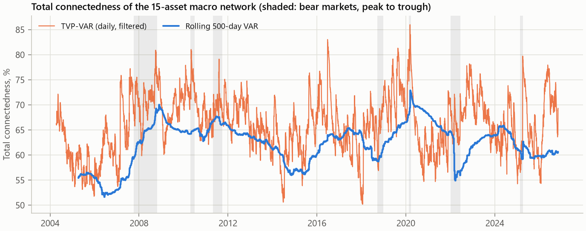

*Total connectedness over time.* Diebold-Yilmaz total connectedness index (TCI): share of 10-day forecast-error variance due to other assets. Shading marks the mechanically dated bear markets.

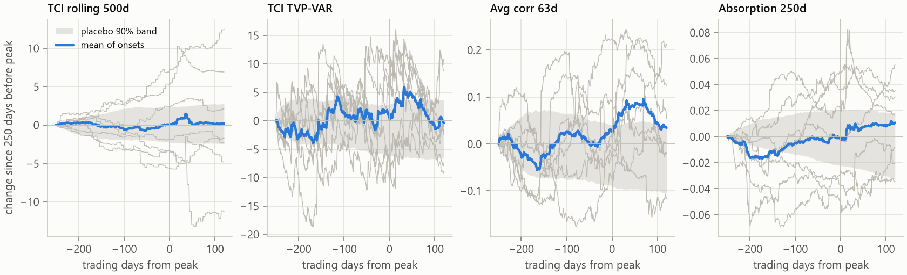

*Event study around bear-market peaks.* Thin gray lines: individual onsets; blue: their mean; gray band: 90% range of the same mean over 1,000 random sets of non-crisis dates. Day 0 = bear-market peak.

- **No systematic pre-crisis rise in connectedness** [Descriptive] Average change in rolling TCI from 250 days before the peak to the peak: +0.1 points vs a placebo mean of +0.0 (p = 0.47); smallest BH-adjusted q across 14 pre-peak tests 0.36.
  - Only 7 independent onsets: low power; a modest true effect could be missed.
  - Rolling 500-day windows react slowly; the TVP-VAR and 63-day correlation are the faster checks.
- **Connectedness rises during crises and tracks volatility** [Descriptive] Change over the 63 days after the peak (placebo p): TCI rolling 500d +0.12 (0.36), TCI rolling 250d +1.53 (0.02), TCI TVP-VAR +1.84 (0.16), Dynamic TCI 500d +0.31 (0.00), Avg corr 63d +0.06 (0.05), Absorption 250d +0.01 (0.01), Granger density +0.01 (0.05).
  - Higher volatility mechanically raises measured correlation (Forbes-Rigobon), so part of the co-movement with volatility is a measurement effect.
- **No incremental out-of-sample value beyond volatility** [Predictive] OOS AUC: baseline (VIX, RV, momentum) 0.552, baseline + connectedness 0.417, connectedness only 0.452; future-volatility regressions lose significance once current volatility is controlled for.
  - Crash labels overlap heavily in time (63-day windows), so the effective sample is small.
  - An AUC below 0.5 for the connectedness model means the 2008-era relation did not carry forward.

### Pre-crisis change in connectedness vs placebo

| indicator | episodes | mean change 250d->peak | episodes up | placebo p (250d) | BH q (250d) | mean change 63d->peak | placebo p (63d) | BH q (63d) | placebo p (250d, 10% dating) | mean change peak->+63d | placebo p (after peak) | corr with 63d realized vol |
|---|---|---|---|---|---|---|---|---|---|---|---|---|
| TCI rolling 500d | 7.00 | 0.07 | 3.00 | 0.47 | 0.68 | 0.71 | 0.05 | 0.36 | 0.71 | 0.12 | 0.36 | 0.39 |
| TCI rolling 250d | 7.00 | 0.49 | 4.00 | 0.41 | 0.68 | 1.24 | 0.04 | 0.36 | 0.85 | 1.53 | 0.02 | 0.45 |
| TCI TVP-VAR | 7.00 | 0.73 | 4.00 | 0.26 | 0.68 | -1.16 | 0.55 | 0.70 | 0.42 | 1.84 | 0.16 | 0.38 |
| Dynamic TCI 500d | 7.00 | -0.48 | 1.00 | 0.78 | 0.84 | -0.22 | 0.89 | 0.89 | 0.62 | 0.31 | 0.00 | 0.43 |
| Avg corr 63d | 7.00 | 0.03 | 3.00 | 0.09 | 0.44 | 0.01 | 0.28 | 0.68 | 0.11 | 0.06 | 0.05 | 0.39 |
| Absorption 250d | 7.00 | -0.00 | 3.00 | 0.48 | 0.68 | -0.00 | 0.40 | 0.68 | 0.88 | 0.01 | 0.01 | 0.37 |
| Granger density | 7.00 | -0.00 | 2.00 | 0.71 | 0.82 | 0.00 | 0.37 | 0.68 | 0.75 | 0.01 | 0.05 | 0.36 |

Change in each indicator from 250 (63) trading days before the bear-market peak to the peak, averaged over onsets. One-sided placebo p-value: share of 5,000 random non-crisis date sets with an equal or larger average rise. BH q: Benjamini-Hochberg adjusted across the 14 pre-peak tests. The 'after peak' columns test the rise over the 63 trading days after the peak the same way.

### Change from 250 trading days before each peak to the peak

|  | TCI rolling 500d | TCI TVP-VAR | Avg corr 63d | Absorption 250d |
|---|---|---|---|---|
| 2007-10-09 | 7.19 | 7.64 | 0.22 | 0.04 |
| 2010-04-23 | -1.88 | 4.70 | -0.03 | 0.05 |
| 2011-04-29 | 2.41 | -10.42 | -0.07 | -0.05 |
| 2018-09-20 | -5.60 | -6.78 | -0.01 | -0.00 |
| 2020-02-19 | 5.30 | 5.95 | 0.01 | 0.02 |
| 2022-01-03 | -3.39 | 11.50 | 0.09 | -0.03 |
| 2025-02-19 | -3.51 | -7.48 | -0.03 | -0.04 |

Points of TCI (percent), correlation units, absorption-ratio units.

### Out-of-sample prediction of a >=10% fall within 63 trading days

|  | AUC (out of sample) |
|---|---|
| baseline (VIX, RV, momentum) | 0.552 |
| baseline + connectedness | 0.417 |
| connectedness only | 0.452 |

Expanding-window logistic regressions refit monthly, OOS 4424 days from 2009 (base rate 11.9%). AUC difference (with - without connectedness) -0.135, 90% block-bootstrap interval [-0.289, +0.029].

### Connectedness and future 63-day volatility (Newey-West t-stats)

|  | coef_per_sd | t_NW | R2 |
|---|---|---|---|
| TCI rolling 500d / alone | 0.130 | 2.920 | 0.081 |
| TCI rolling 500d / with vol controls | 0.013 | 0.328 | 0.375 |
| TCI TVP-VAR / alone | 0.137 | 3.338 | 0.093 |
| TCI TVP-VAR / with vol controls | 0.003 | 0.079 | 0.380 |
| Avg corr 63d / alone | 0.126 | 3.025 | 0.077 |
| Avg corr 63d / with vol controls | 0.033 | 0.960 | 0.380 |
| Absorption 250d / alone | 0.128 | 2.907 | 0.081 |
| Absorption 250d / with vol controls | 0.026 | 0.754 | 0.383 |

Dependent variable: log realized SPY volatility over the next 63 days. Coefficient per one standard deviation of the indicator.

**Robustness**

- 10%/10% crisis dating (9 onsets): placebo p for rolling TCI = 0.71.
- 63-day pre-window: placebo p for rolling TCI = 0.05, for 63-day average correlation = 0.28.
- Granger-network density and the dynamic (lagged) part of TCI are included in the table; they are the only indicators that measure lead-lag structure rather than co-movement.

## Q2. Which assets act as shock transmitters?

In the standard Diebold-Yilmaz sense the transmitters are equities: EFA, SPY, EEM, IWM have the largest NET (+16 to +30 points) and are net transmitters in 94-100% of rolling windows. But 90% of the equity NET comes from same-day correlation, which is symmetric and only says these assets are central. Lagged spillovers carry the directional (predictive) content, and they are small: 2.6% of total connectedness in the macro network and 1.4% in the synchronous one. Their direction tracks how late each series absorbs equity news (Spearman -0.46 between that lag and lagged NET; the close hour alone gives 0.01 because it misses stale marks), and with synchronous prices no asset's lagged NET exceeds 1.9 points. In the tails, VIX, SPY, IWM have the largest Delta-CoVaR out-strength (descriptive). Which asset 'transmits' therefore depends on the definition, and none of these measures identifies a causal transmitter.

*Design.* Full-sample and rolling Diebold-Yilmaz tables (VAR(1), H = 10), with NET split exactly into its same-day and lagged parts; Granger networks with HC1 Wald tests and Benjamini-Hochberg control; Delta-CoVaR tail networks; repeated on a synchronous universe in which every series is priced at the NYSE close.

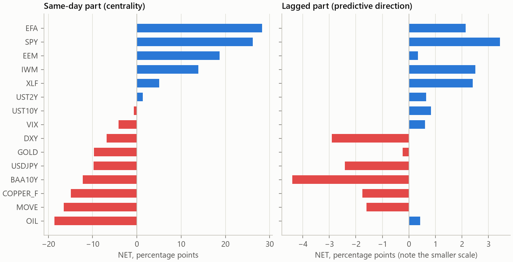

*NET connectedness, split into its two parts.* Full-sample VAR(1), H = 10. Blue: net transmitter, red: net receiver. The two panels add up to the standard DY NET. Same-day correlations contribute symmetrically, so the left panel ranks how central an asset is, not who moves first.

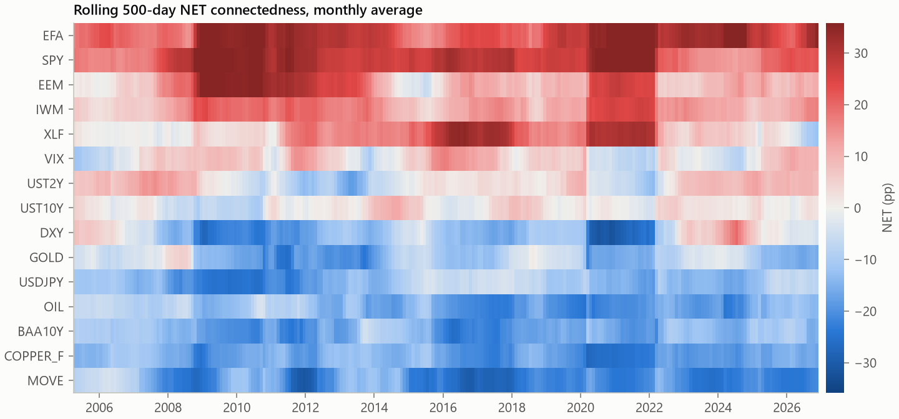

*Who transmits, over time.* Blue = net transmitter, red = net receiver. Equity nodes transmit in almost every window; the sign of most other nodes is stable too, because NET is dominated by centrality.

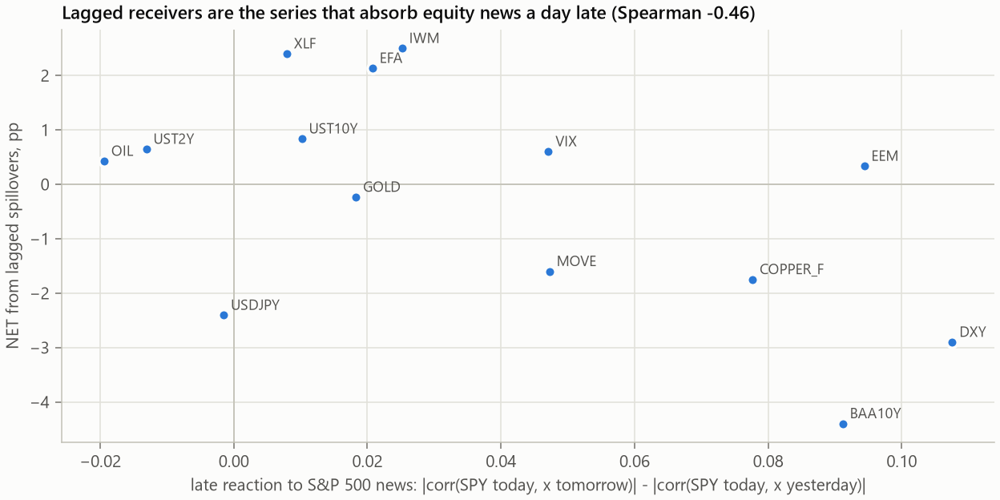

*Lagged NET vs late reaction to equity news.* Series that close before the NYSE (H.10 FX at noon, metals and oil settlements) or carry stale marks (Moody's Baa spread) absorb part of each day's equity news the next day, so a VAR records a lagged link from equities to them. That is a timing artefact, not contagion.

- **Equities are the most central nodes** [Descriptive] Same-day NET: EFA +28.3, SPY +26.2, EEM +18.7, IWM +13.9.
  - Centrality depends on universe composition: adding more equity series raises equities' TO.
- **Lagged spillovers are small and timing-driven** [Predictive] Lagged share of connectedness 2.6% (macro) vs 1.4% (synchronous). Largest lagged receivers in the macro network: BAA10Y -4.4, DXY -2.9, USDJPY -2.4.
  - Predictive links from asynchronous or stale prices are real forecasting relations but not contagion.
- **Rankings are stable in sign, not because of crisis-specific transmission** [Descriptive] Spearman rank correlation of NET between consecutive 3-year blocks: median 0.92 (total NET) vs 0.79 (lagged NET only).

### Transmitter measures, macro network (2003-2026)

|  | TO | FROM | NET | NET same-day | NET lagged | out-degree (pairwise) | out-degree (conditional) | tail out-strength | tail in-strength | close (ET hour) | late reaction to SPY | share of windows net transmitter |
|---|---|---|---|---|---|---|---|---|---|---|---|---|
| EFA | 109.57 | 79.12 | 30.45 | 28.31 | 2.13 | 0.77 | 0.01 | -0.68 | -0.73 | 16.00 | 0.02 | 1.00 |
| SPY | 109.29 | 79.67 | 29.62 | 26.19 | 3.43 | 0.93 | 0.03 | -0.69 | -0.78 | 16.00 | 0.00 | 1.00 |
| EEM | 96.48 | 77.45 | 19.03 | 18.70 | 0.33 | 0.83 | 0.04 | -0.64 | -0.67 | 16.00 | 0.09 | 0.94 |
| IWM | 94.24 | 77.85 | 16.39 | 13.89 | 2.50 | 0.84 | 0.00 | -0.69 | -0.69 | 16.00 | 0.03 | 1.00 |
| XLF | 83.05 | 75.58 | 7.48 | 5.08 | 2.40 | 0.69 | 0.01 | -0.54 | -0.70 | 16.00 | 0.01 | 0.84 |
| UST2Y | 58.59 | 56.65 | 1.95 | 1.30 | 0.64 | 0.34 | 0.02 | -0.40 | -0.41 | 15.50 | -0.01 | 0.63 |
| UST10Y | 57.18 | 57.06 | 0.11 | -0.72 | 0.83 | 0.36 | 0.05 | -0.43 | -0.42 | 15.50 | 0.01 | 0.59 |
| VIX | 68.09 | 71.58 | -3.50 | -4.10 | 0.60 | 0.52 | 0.00 | -0.73 | -0.68 | 16.25 | 0.05 | 0.62 |
| DXY | 39.51 | 49.26 | -9.75 | -6.85 | -2.90 | 0.13 | 0.01 | -0.10 | -0.12 | 17.00 | 0.11 | 0.20 |
| GOLD | 26.25 | 36.17 | -9.92 | -9.68 | -0.24 | 0.54 | 0.20 | 0.11 | 0.03 | 16.00 | 0.02 | 0.05 |
| USDJPY | 31.02 | 43.19 | -12.16 | -9.76 | -2.41 | 0.04 | 0.01 | -0.33 | -0.25 | 12.00 | -0.00 | 0.00 |
| BAA10Y | 27.99 | 44.63 | -16.64 | -12.24 | -4.40 | 0.26 | 0.01 | -0.37 | -0.33 | 16.00 | 0.09 | 0.00 |
| COPPER_F | 31.60 | 48.31 | -16.70 | -14.95 | -1.75 | 0.12 | 0.00 | -0.41 | -0.34 | 13.00 | 0.08 | 0.00 |
| MOVE | 10.05 | 28.17 | -18.12 | -16.52 | -1.60 | 0.06 | 0.00 | -0.35 | -0.24 | 16.00 | 0.05 | 0.00 |
| OIL | 22.49 | 40.72 | -18.24 | -18.66 | 0.42 | 0.32 | 0.00 | -0.42 | -0.34 | 16.00 | -0.02 | 0.00 |

TO/FROM/NET in percentage points of 10-day forecast-error variance (VAR(1), full sample). NET splits exactly into a same-day part (centrality) and a lagged part (predictive direction). Granger degrees: average number of significant out-links per 500-day window (FDR 5%). Tail strength: mean Delta-CoVaR of other assets (in their own SDs) when the asset is in its worst 5% of days.

### Same measures, synchronous universe (all prices at the NYSE close, 2007-2026)

|  | TO | FROM | NET | NET same-day | NET lagged | out-degree (pairwise) | out-degree (conditional) |
|---|---|---|---|---|---|---|---|
| SPY | 110.99 | 82.26 | 28.74 | 26.88 | 1.86 | 0.33 | 0.01 |
| EFA | 109.38 | 81.66 | 27.72 | 26.84 | 0.88 | 0.29 | 0.00 |
| IEF | 88.05 | 72.48 | 15.57 | 16.15 | -0.57 | 0.04 | 0.00 |
| EEM | 95.50 | 80.13 | 15.37 | 16.55 | -1.18 | 0.31 | 0.05 |
| IWM | 95.70 | 80.53 | 15.17 | 14.28 | 0.89 | 0.27 | 0.00 |
| XLF | 85.56 | 78.63 | 6.93 | 5.45 | 1.48 | 0.24 | 0.00 |
| TLT | 70.89 | 69.45 | 1.44 | 1.72 | -0.27 | 0.06 | 0.00 |
| DBC | 63.37 | 67.06 | -3.69 | -3.73 | 0.04 | 0.07 | 0.00 |
| HYG | 65.73 | 73.59 | -7.86 | -8.63 | 0.77 | 0.34 | 0.03 |
| SHY | 54.44 | 62.96 | -8.52 | -8.34 | -0.19 | 0.00 | 0.00 |
| FXY | 47.87 | 59.87 | -12.00 | -10.67 | -1.33 | 0.00 | 0.00 |
| VIX | 60.72 | 73.48 | -12.76 | -12.33 | -0.43 | 0.06 | 0.00 |
| GLD | 23.15 | 38.62 | -15.48 | -15.24 | -0.24 | 0.00 | 0.00 |
| USO | 45.17 | 61.32 | -16.15 | -16.31 | 0.16 | 0.00 | 0.00 |
| UUP | 34.67 | 51.42 | -16.75 | -14.92 | -1.83 | 0.01 | 0.03 |
| LQD | 38.88 | 56.61 | -17.73 | -17.70 | -0.03 | 0.28 | 0.15 |

With every series priced at 16:00 ET, lagged spillovers cannot come from different closing times.

### Largest transmitters inside each bear market (rolling 500-day NET)

| bear market | top NET (total) | top NET (lagged only) | largest receiver (lagged) |
|---|---|---|---|
| 2007-10-09 to 2008-10-27 | SPY +28, EEM +19 | GOLD +4.7, OIL +3.8 | USDJPY -9.1 |
| 2008-11-04 to 2008-11-20 | SPY +37, EFA +34 | SPY +8.2, IWM +7.5 | DXY -21.7 |
| 2009-01-06 to 2009-03-09 | SPY +39, EEM +37 | SPY +9.8, EFA +8.1 | DXY -24.3 |
| 2010-04-23 to 2010-07-02 | EFA +37, SPY +36 | SPY +6.4, IWM +5.2 | DXY -9.3 |
| 2011-04-29 to 2011-10-03 | SPY +35, EFA +34 | UST2Y +2.7, UST10Y +2.7 | BAA10Y -8.0 |
| 2018-09-20 to 2018-12-24 | SPY +26, EFA +20 | UST10Y +2.3, GOLD +1.9 | USDJPY -4.2 |
| 2020-02-19 to 2020-03-23 | SPY +28, EFA +28 | EFA +3.6, SPY +3.4 | GOLD -5.6 |
| 2022-01-03 to 2022-06-16 | EFA +34, SPY +28 | EFA +7.2, SPY +7.1 | DXY -13.5 |
| 2022-08-16 to 2022-10-12 | EFA +31, SPY +21 | IWM +6.3, SPY +6.3 | USDJPY -8.8 |
| 2025-02-19 to 2025-04-08 | EFA +28, SPY +15 | DXY +1.9, UST2Y +1.7 | USDJPY -3.7 |

### Financial institutions: systemic-risk measures

|  | MES 5% (full) | MES 5% (GFC 2007-09) | Delta-CoVaR of SPY | i (bp) | DY TO (fin network) | DY NET lagged |
|---|---|---|---|---|---|
| AIG (American International Group) | 5.47 | 16.89 | -78.67 | 43.82 | 0.52 |
| C (Citigroup) | 5.45 | 12.72 | -114.03 | 87.52 | 0.44 |
| BAC (Bank of America) | 5.24 | 13.61 | -109.43 | 98.79 | 1.03 |
| MS (Morgan Stanley) | 5.21 | 13.59 | -117.83 | 86.91 | 1.19 |
| PRU (Prudential Financial) | 5.06 | 12.64 | -120.95 | 90.85 | 0.51 |
| MET (MetLife) | 4.62 | 9.55 | -129.45 | 87.98 | 0.08 |
| WFC (Wells Fargo) | 4.28 | 9.49 | -110.92 | 96.72 | -0.08 |
| AXP (American Express) | 4.21 | 9.25 | -133.06 | 85.23 | 0.48 |
| JPM (JPMorgan Chase) | 4.08 | 9.62 | -123.27 | 102.27 | -0.22 |
| XLF (Financials (XLF)) | 4.01 | 9.37 | -138.64 | 124.06 | 0.55 |
| GS (Goldman Sachs) | 4.01 | 8.88 | -129.79 | 88.88 | 1.65 |
| BLK (BlackRock) | 3.98 | 6.48 | -141.16 | 73.54 | -1.52 |
| BNY (BNY Mellon) | 3.88 | 10.07 | -127.12 | 88.83 | -1.08 |
| SCHW (Charles Schwab) | 3.88 | 6.79 | -133.35 | 73.58 | -2.38 |
| PNC (PNC Financial) | 3.85 | 8.08 | -115.37 | 91.02 | -0.27 |
| KRE (Regional Banks (KRE)) | 3.80 | 6.69 | -134.17 | 98.23 | -0.29 |
| USB (U.S. Bancorp) | 3.71 | 7.50 | -121.01 | 92.27 | -0.81 |

MES: average loss on the S&P 500's worst 5% of days (percent). Delta-CoVaR: change in the S&P 500's 5% quantile when the institution moves from its median to its own 5% quantile (basis points). DY TO: contribution to other institutions' forecast-error variance in the 18-node financial network.

**Robustness**

- Rolling 250-day windows, VAR(2) and H = 20 versions are stored in outputs/models (dy_macro_w250, dy_macro_w500_p2, dy_macro_w500_h20).
- Granger out-degrees are averaged over rolling windows; conditional (full-VAR) tests control for every other series' lags.
- Fraction of rolling windows in which each asset is a net transmitter is in the first table (SPY 100%, VIX 62%, UST10Y 59%).

## Q3. Which sectors are most vulnerable to rate shocks?

On the descriptive evidence, XLRE Real estate (XLRE), ITB Homebuilders, IYR Real estate, XLU Utilities have the most negative rate betas holding the market fixed, and the lowest betas in the positive stock-bond-correlation (inflation) regime are ITB Homebuilders, XLRE Real estate (XLRE), IYR Real estate. At the other end, XLF Financials, XLE Energy, KRE Regional banks gain relative to the market when yields rise. The causal question, what a policy-driven rate rise does, is answered for the market as a whole but only coarsely by sector. FOMC days raise the variance of the 2Y yield 2.0x relative to control days (90% CI 1.6-2.5; 1.9x outside the zero lower bound). That is enough to identify the S&P 500's response, -0.98% per +10bp policy-driven 2Y move (90% CI -2.07 to -0.33), but only 3 of 18 sector responses relative to the market have a 90% interval excluding zero (Discretionary -0.48%, Comm. services -0.32%, Growth (R1000G) -0.18%). The point estimates rank ITB Homebuilders, XLY Discretionary, XLC Comm. services as most hurt by hawkish surprises. 

*Design.* Daily sector ETF returns 2000-2026; 206 scheduled FOMC announcement days and 2294 control days (non-FOMC Tuesdays and Wednesdays more than two trading days from an announcement). Robustness: the original day-before control design and an ex-zero-lower-bound sample.

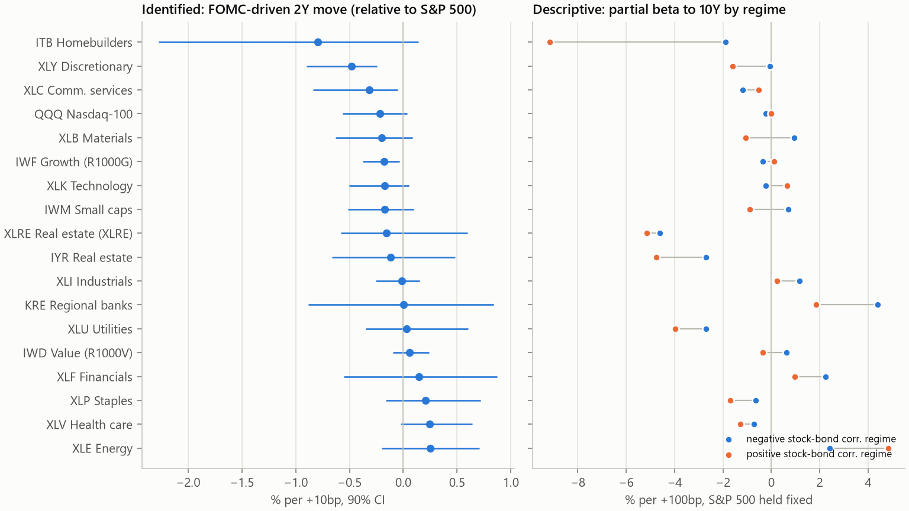

*Sector vulnerability to rate shocks.* Left: causal under the stated identification assumptions. Right: co-movement only; the regime is the sign of the rolling one-year stock-bond correlation known the day before.

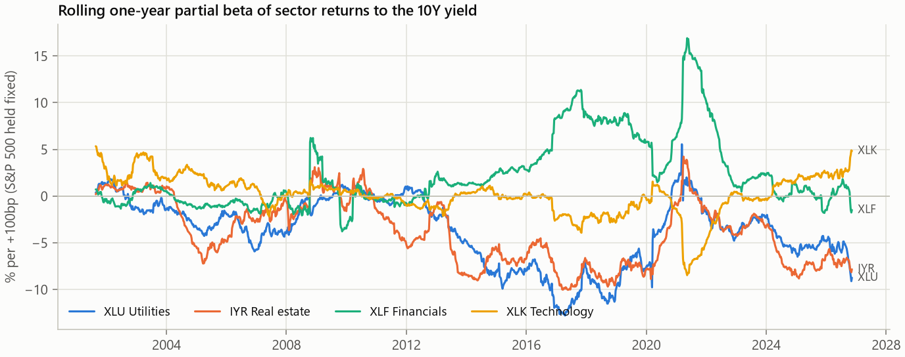

*Rate betas move with the macro regime.* Descriptive. Utilities and real estate lose when yields rise in most windows; financials gain; technology's sign flips with the stock-bond regime.

- **Rate-sensitive sectors under FOMC identification** [Identified] Relative responses per +10bp: ITB -0.80% [-2.27, +0.14], XLY -0.48% [-0.90, -0.24], XLC -0.32% [-0.84, -0.05].
  - Valid only if non-policy shocks have the same variance on FOMC and pre-FOMC days.
  - FOMC surprises mix policy and the Fed's information about the economy.
  - Zero-lower-bound years contribute little identifying variation.
- **Regime dependence of descriptive rate betas** [Descriptive] Partial 10Y beta (negative vs positive stock-bond correlation regime): XLF +2.2 vs +1.0, XLK -0.2 vs +0.7, XLU -2.7 vs -4.0, IWF -0.4 vs +0.1 (% per 100bp).
  - Daily yield changes mix growth, inflation and term-premium news; betas are not causal.

### Sector rate sensitivity: descriptive betas and FOMC-identified responses

|  | total beta (%/100bp) | total t | partial beta (%/100bp) | partial t | partial beta, negative stock-bond corr | partial beta, positive stock-bond corr | rel. return on top-5% yield-rise days (%) | rel. return taper 2013 (%) | rel. return 2022 rate shock (%) | identified rel. response, %/10bp | 90% CI low | 90% CI high | ex-ZLB response, %/10bp | ex-ZLB CI low | ex-ZLB CI high | day-before design, %/10bp |
|---|---|---|---|---|---|---|---|---|---|---|---|---|---|---|---|---|
| ITB Homebuilders | 4.15 | 3.93 | -3.51 | -5.42 | -1.88 | -9.17 | -0.32 | -9.00 | -8.38 | -0.80 | -2.27 | 0.14 | -0.32 | -2.30 | 0.71 | -1.09 |
| XLY Discretionary | 5.68 | 10.57 | -0.29 | -1.29 | -0.06 | -1.60 | -0.01 | 0.48 | -9.02 | -0.48 | -0.90 | -0.24 | -0.57 | -1.27 | -0.27 | -0.43 |
| XLC Comm. services | 1.17 | 1.12 | -0.82 | -2.67 | -1.18 | -0.53 | 0.02 |  | -14.18 | -0.32 | -0.84 | -0.05 | -0.30 | -0.77 | -0.01 | -0.45 |
| QQQ Nasdaq-100 | 6.72 | 11.11 | -0.03 | -0.13 | -0.23 | -0.01 | 0.18 | -0.27 | -9.79 | -0.22 | -0.56 | 0.04 | -0.38 | -0.96 | -0.08 | -0.06 |
| XLB Materials | 6.34 | 11.54 | 0.60 | 2.58 | 0.95 | -1.06 | -0.01 | -1.21 | 2.41 | -0.20 | -0.63 | 0.09 | -0.02 | -0.53 | 0.36 | -0.08 |
| IWF Growth (R1000G) | 5.80 | 11.15 | -0.22 | -1.41 | -0.36 | 0.10 | 0.03 | -0.63 | -7.41 | -0.18 | -0.38 | -0.03 | -0.32 | -0.65 | -0.16 | -0.02 |
| XLK Technology | 6.95 | 11.49 | 0.16 | 0.61 | -0.23 | 0.66 | 0.19 | -0.08 | -8.63 | -0.17 | -0.50 | 0.05 | -0.33 | -0.87 | -0.05 | -0.14 |
| IWM Small caps | 6.71 | 11.43 | 0.29 | 1.35 | 0.71 | -0.89 | 0.01 | 1.00 | -0.54 | -0.17 | -0.51 | 0.10 | -0.11 | -0.51 | 0.21 | -0.34 |
| XLRE Real estate (XLRE) | -2.49 | -2.18 | -4.64 | -8.96 | -4.60 | -5.14 | -0.58 |  | -7.74 | -0.15 | -0.58 | 0.60 | -0.08 | -0.59 | 0.79 | -0.08 |
| IYR Real estate | 3.17 | 4.29 | -2.57 | -7.17 | -2.70 | -4.77 | -0.29 | -9.71 | -6.84 | -0.12 | -0.66 | 0.48 | 0.43 | -0.08 | 1.25 | -0.26 |
| XLI Industrials | 6.72 | 13.66 | 1.07 | 6.17 | 1.18 | 0.22 | 0.07 | -0.21 | 6.29 | -0.02 | -0.26 | 0.15 | 0.11 | -0.15 | 0.33 | 0.09 |
| KRE Regional banks | 10.88 | 11.17 | 3.81 | 6.27 | 4.39 | 1.84 | 0.43 | 4.27 | 8.79 | 0.00 | -0.88 | 0.84 | -0.03 | -1.03 | 0.96 | -0.71 |
| XLU Utilities | 1.33 | 2.58 | -2.40 | -8.35 | -2.69 | -3.97 | -0.53 | -2.69 | 13.18 | 0.03 | -0.35 | 0.60 | 0.32 | -0.13 | 1.20 | 0.24 |
| IWD Value (R1000V) | 5.98 | 11.74 | 0.57 | 4.63 | 0.63 | -0.35 | 0.02 | 0.08 | 6.89 | 0.06 | -0.09 | 0.24 | 0.18 | 0.02 | 0.47 | -0.01 |
| XLF Financials | 8.95 | 11.38 | 1.98 | 4.57 | 2.23 | 0.96 | 0.41 | -0.36 | 2.24 | 0.15 | -0.55 | 0.87 | 0.63 | 0.11 | 1.32 | -0.40 |
| XLP Staples | 2.28 | 6.55 | -0.79 | -3.78 | -0.66 | -1.70 | -0.37 | 0.68 | 13.88 | 0.21 | -0.16 | 0.72 | 0.12 | -0.28 | 0.84 | 0.68 |
| XLV Health care | 3.72 | 9.43 | -0.46 | -2.22 | -0.71 | -1.28 | -0.18 | 1.11 | 12.91 | 0.25 | -0.03 | 0.64 | 0.19 | -0.11 | 0.75 | 0.56 |
| XLE Energy | 8.39 | 12.65 | 2.75 | 6.24 | 2.41 | 4.83 | 0.07 | -1.34 | 69.00 | 0.25 | -0.20 | 0.71 | 0.31 | -0.21 | 0.90 | -0.29 |

Betas: percent sector return per +100bp in the 10Y yield (daily, Newey-West t). Partial betas hold the S&P 500 fixed. Identified response: percent return RELATIVE TO THE S&P 500 per +10bp move in the 2Y yield driven by FOMC news (identification through heteroskedasticity, meeting-paired bootstrap). Sorted from most to least vulnerable to policy tightening.

**Robustness**

- Excluding zero-lower-bound meetings (fed funds < 0.25%): variance ratio 1.9x; estimates in the ex-ZLB columns.
- Day-before controls (Rigobon & Sack's design): variance ratio 1.7x; Spearman rank correlation with the main estimates 0.47.
- 3-month bill yields are not a usable policy indicator here: their variance is not higher on FOMC days.
- The descriptive top-5% yield-rise-day returns and the 2013 / 2022 episode returns are in the table; in 2022 defensives outperformed despite negative rate betas because the shock was inflation, not rates alone.

## Q4. Can dynamic networks improve portfolio stress testing?

Yes. 5 of 7 time-varying networks (ewma 0.97, ewma 0.94, dcc, rolling 63d, rolling 252d) beat the static (expanding full-history) network on stress days with Diebold-Mariano p < 0.05; regime (HMM) and stressed (high VIX) do worse. The best, ewma 0.97, changes the scaled prediction error of the same-day cross-section by -18% (DM t = -3.9), beats static on 73% of stress days, and lowers the error of predicted portfolio P&L by 16-30% across the five portfolios. The winners all weight recent data heavily, so they follow the current dependence structure; covariances conditioned on past stress (regime (HMM) and stressed (high VIX)) do worse, consistent with crises differing from one another (the stock-bond correlation had opposite signs in 2008-2020 and in 2022). No model is well calibrated: their nominal 90% intervals cover only 62-80% of realized stress-day moves (62% for static). Among years with at least 10 stress days, ewma 0.97 gains most in 2010, 2026 and least in 2011. The lagged network adds little: a rolling VAR predicts the day after an S&P 500 shock better than 'no further move' mainly for DXY, BAA10Y, EEM, series that absorb part of each day's S&P 500 news only the next day (late-reaction scores DXY +0.10, BAA10Y +0.09, EEM +0.11: earlier closes, stale marks or foreign underlying markets). That multi-day 'propagation' is a timing effect.

*Design.* 239 stress days (driver moves beyond the expanding 98th percentile) from 2010 to 2026 across six drivers (BAA10Y 50, DXY 36, OIL 73, SPY 33, UST10Y 51, VIX 89); 31-series stress universe; every model uses data up to the previous close only.

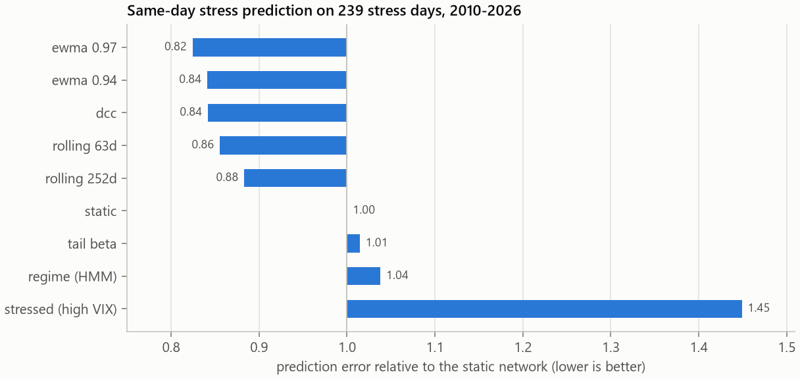

*Dynamic vs static networks in out-of-sample stress tests.* Each bar is the mean scaled squared error of the predicted cross-section of moves on stress days, relative to the static (expanding full-history) network.

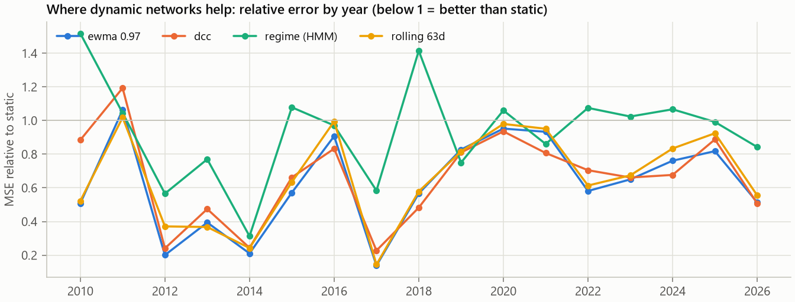

*Gains by year.* Relative error of four time-varying networks against the static network, by calendar year of the stress day. Below 1: the time-varying network predicted the cross-section better.

- **Best stress-day predictor: ewma 0.97** [Predictive] Relative MSE 0.82 (DM t -3.9, p 0.000); coverage 69% vs 62% static.
  - Stress days cluster in time, so the effective number of independent events is smaller than the count.
  - Conditional expectations describe co-movement given the scenario; they do not identify causes.
- **Lagged propagation is mostly timing** [Predictive] Next-day MSE reduction from the VAR: DXY +33%, BAA10Y +17%, EEM +10%, VIX +4%.
  - A predictable catch-up of stale or early-closing prices is useful for risk reporting but is not contagion.
- **Crisis-conditioned covariances do worse than static** [Predictive] regime (HMM): relative MSE 1.04 (DM p 0.25), stressed (high VIX): relative MSE 1.45 (DM p 0.00).
  - Stressed and regime covariances import the correlations of past crises (flight to quality); 2022-type inflation shocks had different ones.

### Out-of-sample conditional stress prediction, all stress days

| model | events | mse_scaled | coverage90 | r2_vs_zero | rel. MSE vs static | DM t | DM p | share of events better than static |
|---|---|---|---|---|---|---|---|---|
| ewma 0.97 | 332.000 | 3.792 | 0.693 | 0.252 | 0.825 | -3.898 | 0.000 | 0.732 |
| ewma 0.94 | 332.000 | 3.868 | 0.695 | 0.218 | 0.841 | -3.248 | 0.001 | 0.714 |
| dcc | 332.000 | 3.872 | 0.742 | 0.277 | 0.842 | -3.860 | 0.000 | 0.762 |
| rolling 63d | 332.000 | 3.934 | 0.659 | 0.185 | 0.856 | -3.185 | 0.001 | 0.693 |
| rolling 252d | 332.000 | 4.061 | 0.624 | 0.205 | 0.883 | -3.745 | 0.000 | 0.714 |
| static | 332.000 | 4.598 | 0.617 | -0.098 | 1.000 |  |  | 0.000 |
| tail beta | 332.000 | 4.665 | 0.804 | -0.167 | 1.015 | 1.022 | 0.307 | 0.479 |
| regime (HMM) | 332.000 | 4.773 | 0.683 | -0.106 | 1.038 | 1.143 | 0.253 | 0.539 |
| stressed (high VIX) | 332.000 | 6.663 | 0.771 | -1.359 | 1.449 | 6.109 | 0.000 | 0.214 |

Stress days: a driver's absolute move exceeds its expanding 98th percentile (data from t-1 only). mse_scaled: mean squared error of the 30 non-shocked series' same-day moves, each scaled by its standard deviation. coverage90: share of realized moves inside the model's 90% conditional interval (nominal 0.90). r2_vs_zero: share of the cross-section explained relative to predicting no move. DM: Diebold-Mariano test of the per-event loss difference against the static network.

### Relative MSE by scenario driver (static = 1.00)

| driver | dcc | ewma 0.94 | ewma 0.97 | regime (HMM) | rolling 252d | rolling 63d | static | stressed (high VIX) | tail beta |
|---|---|---|---|---|---|---|---|---|---|
| BAA10Y | 0.97 | 1.02 | 0.97 | 1.01 | 0.95 | 0.97 | 1.00 | 1.02 | 0.99 |
| DXY | 0.94 | 0.96 | 0.93 | 1.07 | 0.93 | 0.95 | 1.00 | 1.11 | 1.01 |
| OIL | 0.75 | 0.76 | 0.78 | 1.14 | 0.85 | 0.86 | 1.00 | 1.36 | 1.06 |
| SPY | 1.03 | 0.91 | 0.90 | 0.99 | 0.95 | 0.91 | 1.00 | 1.00 | 1.00 |
| UST10Y | 0.87 | 0.81 | 0.79 | 1.04 | 0.86 | 0.79 | 1.00 | 1.14 | 1.00 |
| VIX | 0.59 | 0.64 | 0.62 | 0.95 | 0.79 | 0.69 | 1.00 | 2.89 | 1.02 |

### Relative portfolio P&L error (static = 1.00)

| model | 60/40 | Global multi-asset | Risk-balanced | US sectors equal-weight | Bank-heavy equity |
|---|---|---|---|---|---|
| dcc | 0.77 | 0.76 | 0.84 | 0.78 | 0.74 |
| ewma 0.94 | 0.73 | 0.72 | 0.85 | 0.69 | 0.68 |
| ewma 0.97 | 0.73 | 0.72 | 0.84 | 0.70 | 0.70 |
| regime (HMM) | 0.98 | 1.00 | 1.00 | 0.96 | 0.97 |
| rolling 252d | 0.84 | 0.82 | 0.90 | 0.80 | 0.78 |
| rolling 63d | 0.78 | 0.75 | 0.87 | 0.73 | 0.73 |
| static | 1.00 | 1.00 | 1.00 | 1.00 | 1.00 |
| stressed (high VIX) | 1.43 | 1.48 | 1.32 | 1.42 | 1.42 |
| tail beta | 1.00 | 1.02 | 1.01 | 1.00 | 1.00 |

Mean absolute error of the predicted same-day portfolio P&L, relative to the static network.

### Lagged network: next-day propagation after S&P 500 stress days

|  | next-day MSE reduction vs no-change (%) | late reaction to SPY |
|---|---|---|
| DXY | 33.34 | 0.10 |
| BAA10Y | 17.16 | 0.09 |
| EEM | 9.63 | 0.11 |
| VIX | 3.64 | 0.05 |
| KRE | 2.21 | 0.03 |
| XLF | 0.21 | 0.01 |
| EFA | -2.36 | 0.02 |
| IYR | -4.20 | 0.06 |
| LQD | -4.38 | 0.04 |
| XLK | -4.53 | 0.04 |
| HYG | -6.62 | -0.05 |
| XLY | -8.09 | 0.01 |

Rolling 500-day VAR(1). Positive = the VAR's prediction of the day after the shock beats 'no further move'. Late reaction: |corr(SPY today, x tomorrow)| - |corr(SPY today, x yesterday)|.

**Robustness**

- Per-driver results (table) show where the dynamic models gain: by construction the scenario driver's own variance cancels, so the gains come from the correlation structure.
- The tail-beta model uses only the driver's own past tail days; with few tail observations it is noisy, which is visible in its error.

## Q5. Are correlations more informative during tail events?

Partly. On the S&P 500's worst 5% of days, 6 of 6 risky assets (EFA, EEM, XLF, HYG, USO, DBC) are more correlated with it than a Gaussian with the same overall dependence implies; under that Gaussian the correlation would shrink toward zero in the tail, so an excess is tail dependence rather than a conditioning artefact. Treasuries and the yen show the mirror image: they rally on the S&P 500's worst days more often than a Gaussian implies (crash-and-rally frequency IEF 0.32 vs 0.13, TLT 0.30 vs 0.13, FXY 0.26 vs 0.13). As forecasts, correlations measured on past tail days predict the next year's tail-day correlations with a mean absolute error of 0.257, against 0.252 for the full history and 0.234 for the last 252 days (lowest error: past calm days; past tail days beat the full history in 20% of years, DM t = 1.0). For a multi-asset portfolio's volatility on tail days the errors are 9.3% with tail correlations vs 10.9% with the full history. Crisis-correlation rises survive the Forbes-Rigobon volatility adjustment in 16 of the 30 pair-crisis cases that are significant unadjusted.

*Design.* Synchronous ETF universe (16 series, all priced at the NYSE close) from 2007-04; Gaussian benchmarks use each pair's normal-scores correlation; bear markets dated as in Q1.

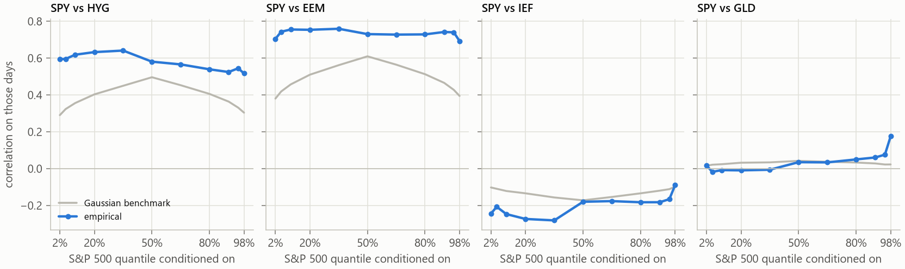

*Correlation on the S&P 500's tail days.* Left of 50%: correlation on days when the S&P 500 is at or below that quantile; right: at or above. Gray: what a bivariate Gaussian with the same normal-scores correlation implies (shrinking toward zero in both tails). Blue above gray in the left tail = stronger co-movement on bad days than a Gaussian allows.

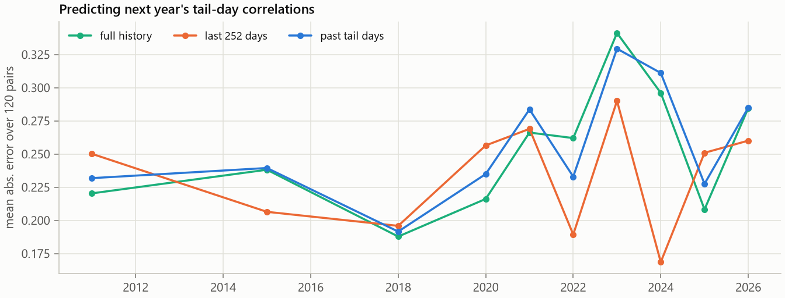

*Out-of-sample: which past correlations predict tail co-movement?.* Lower is better. Each point predicts the correlations realized on that year's market-tail days.

- **Tail correlation of risky assets vs the Gaussian benchmark** [Descriptive] EFA: 0.83 vs Gaussian 0.51, EEM: 0.74 vs Gaussian 0.42, XLF: 0.75 vs Gaussian 0.47, HYG: 0.60 vs Gaussian 0.32, USO: 0.47 vs Gaussian 0.11, DBC: 0.49 vs Gaussian 0.13.
  - Conditional correlations on 5% of days use ~250 observations; intervals in the table.
- **Forecasting future tail-day correlations** [Predictive] MAE: past tail days 0.257, full history 0.252, last 252 days 0.234.
  - Only ~16 forecast years; year-to-year variation is large (figure).
- **Crisis correlation rises before and after the volatility adjustment** [Descriptive] Significant rises: 30 unadjusted vs 16 Forbes-Rigobon adjusted (of 96 pair-crisis cases).
  - The FR adjustment assumes no common shocks and no feedback; it can over-correct.

### Dependence with the S&P 500 in the tails vs a Gaussian benchmark (2007-2026)

|  | full-sample corr | corr | SPY worst 5% | 90% CI | Gaussian benchmark | corr | SPY best 5% | Gaussian (best 5%) | co-crash freq / q | Gaussian co-crash | crash & rally freq / q | Gaussian crash & rally | best copula (AIC) | t-copula nu |
|---|---|---|---|---|---|---|---|---|---|---|---|---|
| SPY-EFA | 0.89 | 0.83 | [0.75, 0.88] | 0.51 | 0.82 | 0.52 | 0.66 | 0.56 | 0.00 | 0.00 | student_t | 4.47 |
| SPY-EEM | 0.82 | 0.74 | [0.65, 0.80] | 0.42 | 0.74 | 0.43 | 0.59 | 0.48 | 0.00 | 0.00 | student_t | 4.22 |
| SPY-XLF | 0.84 | 0.75 | [0.68, 0.83] | 0.47 | 0.63 | 0.48 | 0.68 | 0.53 | 0.00 | 0.00 | student_t | 2.82 |
| SPY-HYG | 0.68 | 0.60 | [0.50, 0.71] | 0.32 | 0.54 | 0.33 | 0.53 | 0.38 | 0.01 | 0.00 | student_t | 3.01 |
| SPY-LQD | 0.20 | 0.35 | [0.13, 0.48] | 0.04 | 0.30 | 0.04 | 0.17 | 0.08 | 0.11 | 0.03 | student_t | 3.36 |
| SPY-USO | 0.33 | 0.47 | [0.33, 0.59] | 0.11 | 0.15 | 0.11 | 0.30 | 0.14 | 0.03 | 0.01 | student_t | 3.32 |
| SPY-DBC | 0.39 | 0.49 | [0.39, 0.59] | 0.13 | 0.26 | 0.13 | 0.32 | 0.16 | 0.02 | 0.01 | student_t | 3.33 |
| SPY-IEF | -0.29 | -0.21 | [-0.33, -0.09] | -0.11 | -0.17 | -0.11 | 0.05 | 0.01 | 0.32 | 0.13 | student_t | 3.00 |
| SPY-TLT | -0.30 | -0.23 | [-0.36, -0.11] | -0.11 | -0.19 | -0.11 | 0.05 | 0.01 | 0.30 | 0.13 | student_t | 3.36 |
| SPY-GLD | 0.06 | -0.02 | [-0.18, 0.15] | 0.02 | 0.08 | 0.02 | 0.13 | 0.07 | 0.15 | 0.04 | student_t | 3.50 |
| SPY-UUP | -0.19 | -0.05 | [-0.26, 0.13] | -0.08 | -0.02 | -0.08 | 0.08 | 0.02 | 0.21 | 0.11 | student_t | 3.44 |
| SPY-FXY | -0.30 | -0.27 | [-0.35, -0.16] | -0.11 | -0.30 | -0.11 | 0.04 | 0.01 | 0.26 | 0.13 | student_t | 4.12 |

Conditional correlations on the S&P 500's worst / best 5% of days, with a block-bootstrap 90% interval, against a bivariate Gaussian with the same normal-scores correlation (which predicts tail correlations SHRINKING toward zero). 'freq / q': empirical joint-exceedance frequency at the 5% level divided by 5% (co-crash: both in their worst 5%; crash & rally: SPY worst 5% with the other asset in its best 5%).

### Contagion or interdependence? Crisis vs pre-crisis correlations

|  | calm corr | crisis corr | FR-adjusted | SPY variance ratio | rise (unadj.) p | rise (adj.) p |
|---|---|---|---|---|---|---|
| 2009-01-06..2009-03-09 / SPY-EFA | 0.94 | 0.94 | 0.95 | 0.79 | 0.63 | 0.37 |
| 2009-01-06..2009-03-09 / SPY-EEM | 0.91 | 0.94 | 0.95 | 0.79 | 0.08 | 0.02 |
| 2009-01-06..2009-03-09 / SPY-XLF | 0.84 | 0.88 | 0.90 | 0.79 | 0.22 | 0.08 |
| 2009-01-06..2009-03-09 / SPY-HYG | 0.56 | 0.67 | 0.71 | 0.79 | 0.15 | 0.06 |
| 2009-01-06..2009-03-09 / SPY-LQD | 0.26 | 0.19 | 0.21 | 0.79 | 0.67 | 0.62 |
| 2009-01-06..2009-03-09 / SPY-USO | 0.42 | 0.57 | 0.62 | 0.79 | 0.12 | 0.05 |
| 2009-01-06..2009-03-09 / SPY-DBC | 0.42 | 0.63 | 0.67 | 0.79 | 0.05 | 0.02 |
| 2009-01-06..2009-03-09 / SPY-IEF | -0.48 | -0.48 | -0.53 | 0.79 | 0.51 | 0.65 |
| 2009-01-06..2009-03-09 / SPY-TLT | -0.49 | -0.47 | -0.52 | 0.79 | 0.46 | 0.60 |
| 2009-01-06..2009-03-09 / SPY-GLD | 0.00 | -0.18 | -0.20 | 0.79 | 0.86 | 0.89 |
| 2009-01-06..2009-03-09 / SPY-UUP | -0.11 | -0.63 | -0.67 | 0.79 | 1.00 | 1.00 |
| 2009-01-06..2009-03-09 / SPY-FXY | -0.66 | -0.47 | -0.52 | 0.79 | 0.05 | 0.10 |
| 2010-04-23..2010-07-02 / SPY-EFA | 0.90 | 0.94 | 0.87 | 2.49 | 0.06 | 0.86 |
| 2010-04-23..2010-07-02 / SPY-EEM | 0.89 | 0.94 | 0.86 | 2.49 | 0.03 | 0.74 |
| 2010-04-23..2010-07-02 / SPY-XLF | 0.86 | 0.96 | 0.91 | 2.49 | 0.00 | 0.08 |
| 2010-04-23..2010-07-02 / SPY-HYG | 0.66 | 0.81 | 0.66 | 2.49 | 0.02 | 0.49 |
| 2010-04-23..2010-07-02 / SPY-LQD | 0.06 | 0.08 | 0.05 | 2.49 | 0.45 | 0.52 |
| 2010-04-23..2010-07-02 / SPY-USO | 0.61 | 0.75 | 0.59 | 2.49 | 0.05 | 0.61 |
| 2010-04-23..2010-07-02 / SPY-DBC | 0.65 | 0.76 | 0.60 | 2.49 | 0.09 | 0.72 |
| 2010-04-23..2010-07-02 / SPY-IEF | -0.34 | -0.80 | -0.65 | 2.49 | 1.00 | 1.00 |
| 2010-04-23..2010-07-02 / SPY-TLT | -0.31 | -0.78 | -0.62 | 2.49 | 1.00 | 0.99 |
| 2010-04-23..2010-07-02 / SPY-GLD | 0.43 | -0.19 | -0.12 | 2.49 | 1.00 | 1.00 |
| 2010-04-23..2010-07-02 / SPY-UUP | -0.42 | -0.47 | -0.32 | 2.49 | 0.64 | 0.22 |
| 2010-04-23..2010-07-02 / SPY-FXY | -0.33 | -0.69 | -0.52 | 2.49 | 1.00 | 0.93 |
| 2011-04-29..2011-10-03 / SPY-EFA | 0.92 | 0.94 | 0.87 | 2.42 | 0.10 | 0.98 |
| 2011-04-29..2011-10-03 / SPY-EEM | 0.89 | 0.92 | 0.84 | 2.42 | 0.05 | 0.96 |
| 2011-04-29..2011-10-03 / SPY-XLF | 0.93 | 0.95 | 0.89 | 2.42 | 0.04 | 0.96 |
| 2011-04-29..2011-10-03 / SPY-HYG | 0.77 | 0.84 | 0.71 | 2.42 | 0.03 | 0.87 |
| 2011-04-29..2011-10-03 / SPY-LQD | -0.11 | -0.27 | -0.18 | 2.42 | 0.93 | 0.73 |
| 2011-04-29..2011-10-03 / SPY-USO | 0.53 | 0.68 | 0.52 | 2.42 | 0.02 | 0.56 |
| 2011-04-29..2011-10-03 / SPY-DBC | 0.62 | 0.56 | 0.40 | 2.42 | 0.78 | 1.00 |
| 2011-04-29..2011-10-03 / SPY-IEF | -0.52 | -0.67 | -0.50 | 2.42 | 0.98 | 0.41 |
| 2011-04-29..2011-10-03 / SPY-TLT | -0.56 | -0.70 | -0.53 | 2.42 | 0.98 | 0.37 |
| 2011-04-29..2011-10-03 / SPY-GLD | 0.05 | -0.30 | -0.19 | 2.42 | 1.00 | 0.98 |
| 2011-04-29..2011-10-03 / SPY-UUP | -0.46 | -0.59 | -0.43 | 2.42 | 0.95 | 0.38 |
| 2011-04-29..2011-10-03 / SPY-FXY | -0.40 | 0.09 | 0.06 | 2.42 | 0.00 | 0.00 |
| 2018-09-20..2018-12-24 / SPY-EFA | 0.82 | 0.87 | 0.74 | 2.72 | 0.09 | 0.94 |
| 2018-09-20..2018-12-24 / SPY-EEM | 0.76 | 0.78 | 0.60 | 2.72 | 0.39 | 0.99 |
| 2018-09-20..2018-12-24 / SPY-XLF | 0.83 | 0.85 | 0.70 | 2.72 | 0.27 | 0.98 |
| 2018-09-20..2018-12-24 / SPY-HYG | 0.72 | 0.80 | 0.63 | 2.72 | 0.09 | 0.88 |
| 2018-09-20..2018-12-24 / SPY-LQD | 0.09 | 0.21 | 0.13 | 2.72 | 0.19 | 0.38 |
| 2018-09-20..2018-12-24 / SPY-USO | 0.33 | 0.25 | 0.16 | 2.72 | 0.73 | 0.91 |
| 2018-09-20..2018-12-24 / SPY-DBC | 0.33 | 0.30 | 0.19 | 2.72 | 0.59 | 0.86 |
| 2018-09-20..2018-12-24 / SPY-IEF | -0.34 | -0.45 | -0.29 | 2.72 | 0.82 | 0.35 |
| 2018-09-20..2018-12-24 / SPY-TLT | -0.20 | -0.35 | -0.22 | 2.72 | 0.87 | 0.56 |
| 2018-09-20..2018-12-24 / SPY-GLD | 0.07 | -0.25 | -0.15 | 2.72 | 0.99 | 0.94 |
| 2018-09-20..2018-12-24 / SPY-UUP | -0.13 | -0.01 | -0.01 | 2.72 | 0.19 | 0.19 |
| 2018-09-20..2018-12-24 / SPY-FXY | -0.28 | -0.53 | -0.35 | 2.72 | 0.98 | 0.72 |
| 2020-02-19..2020-03-23 / SPY-EFA | 0.87 | 0.96 | 0.46 | 40.79 | 0.01 | 1.00 |
| 2020-02-19..2020-03-23 / SPY-EEM | 0.75 | 0.93 | 0.36 | 40.79 | 0.00 | 1.00 |
| 2020-02-19..2020-03-23 / SPY-XLF | 0.87 | 0.97 | 0.56 | 40.79 | 0.00 | 1.00 |
| 2020-02-19..2020-03-23 / SPY-HYG | 0.81 | 0.92 | 0.34 | 40.79 | 0.03 | 1.00 |
| 2020-02-19..2020-03-23 / SPY-LQD | -0.10 | 0.25 | 0.04 | 40.79 | 0.06 | 0.27 |
| 2020-02-19..2020-03-23 / SPY-USO | 0.32 | 0.66 | 0.14 | 40.79 | 0.02 | 0.80 |
| 2020-02-19..2020-03-23 / SPY-DBC | 0.35 | 0.75 | 0.18 | 40.79 | 0.00 | 0.79 |
| 2020-02-19..2020-03-23 / SPY-IEF | -0.50 | -0.56 | -0.10 | 40.79 | 0.64 | 0.03 |
| 2020-02-19..2020-03-23 / SPY-TLT | -0.47 | -0.50 | -0.09 | 40.79 | 0.55 | 0.03 |
| 2020-02-19..2020-03-23 / SPY-GLD | -0.30 | 0.01 | 0.00 | 40.79 | 0.08 | 0.09 |
| 2020-02-19..2020-03-23 / SPY-UUP | 0.09 | 0.61 | 0.12 | 40.79 | 0.00 | 0.45 |
| 2020-02-19..2020-03-23 / SPY-FXY | -0.53 | -0.68 | -0.15 | 40.79 | 0.86 | 0.03 |
| 2022-01-03..2022-06-16 / SPY-EFA | 0.82 | 0.85 | 0.64 | 3.81 | 0.16 | 1.00 |
| 2022-01-03..2022-06-16 / SPY-EEM | 0.62 | 0.72 | 0.47 | 3.81 | 0.05 | 0.97 |
| 2022-01-03..2022-06-16 / SPY-XLF | 0.67 | 0.86 | 0.65 | 3.81 | 0.00 | 0.63 |
| 2022-01-03..2022-06-16 / SPY-HYG | 0.77 | 0.75 | 0.51 | 3.81 | 0.66 | 1.00 |
| 2022-01-03..2022-06-16 / SPY-LQD | 0.18 | 0.35 | 0.19 | 3.81 | 0.06 | 0.47 |
| 2022-01-03..2022-06-16 / SPY-USO | 0.36 | -0.03 | -0.02 | 3.81 | 1.00 | 1.00 |
| 2022-01-03..2022-06-16 / SPY-DBC | 0.39 | 0.04 | 0.02 | 3.81 | 1.00 | 1.00 |
| 2022-01-03..2022-06-16 / SPY-IEF | -0.08 | 0.01 | 0.00 | 3.81 | 0.22 | 0.23 |
| 2022-01-03..2022-06-16 / SPY-TLT | -0.14 | -0.02 | -0.01 | 3.81 | 0.16 | 0.13 |
| 2022-01-03..2022-06-16 / SPY-GLD | 0.19 | -0.11 | -0.06 | 3.81 | 1.00 | 0.99 |
| 2022-01-03..2022-06-16 / SPY-UUP | -0.28 | -0.41 | -0.23 | 3.81 | 0.91 | 0.32 |
| 2022-01-03..2022-06-16 / SPY-FXY | -0.10 | -0.18 | -0.09 | 3.81 | 0.76 | 0.48 |
| 2022-08-16..2022-10-12 / SPY-EFA | 0.84 | 0.90 | 0.87 | 1.35 | 0.09 | 0.27 |
| 2022-08-16..2022-10-12 / SPY-EEM | 0.69 | 0.87 | 0.84 | 1.35 | 0.00 | 0.02 |
| 2022-08-16..2022-10-12 / SPY-XLF | 0.84 | 0.95 | 0.93 | 1.35 | 0.00 | 0.01 |
| 2022-08-16..2022-10-12 / SPY-HYG | 0.76 | 0.91 | 0.88 | 1.35 | 0.00 | 0.01 |
| 2022-08-16..2022-10-12 / SPY-LQD | 0.31 | 0.61 | 0.55 | 1.35 | 0.01 | 0.04 |
| 2022-08-16..2022-10-12 / SPY-USO | 0.12 | 0.30 | 0.26 | 1.35 | 0.14 | 0.19 |
| 2022-08-16..2022-10-12 / SPY-DBC | 0.15 | 0.34 | 0.30 | 1.35 | 0.11 | 0.18 |
| 2022-08-16..2022-10-12 / SPY-IEF | -0.03 | 0.44 | 0.39 | 1.35 | 0.00 | 0.01 |
| 2022-08-16..2022-10-12 / SPY-TLT | -0.08 | 0.25 | 0.22 | 1.35 | 0.03 | 0.04 |
| 2022-08-16..2022-10-12 / SPY-GLD | -0.05 | 0.68 | 0.62 | 1.35 | 0.00 | 0.00 |
| 2022-08-16..2022-10-12 / SPY-UUP | -0.35 | -0.67 | -0.61 | 1.35 | 0.99 | 0.98 |
| 2022-08-16..2022-10-12 / SPY-FXY | -0.12 | 0.39 | 0.34 | 1.35 | 0.00 | 0.00 |
| 2025-02-19..2025-04-08 / SPY-EFA | 0.69 | 0.75 | 0.48 | 4.48 | 0.26 | 0.96 |
| 2025-02-19..2025-04-08 / SPY-EEM | 0.61 | 0.70 | 0.42 | 4.48 | 0.19 | 0.91 |
| 2025-02-19..2025-04-08 / SPY-XLF | 0.62 | 0.90 | 0.71 | 4.48 | 0.00 | 0.20 |
| 2025-02-19..2025-04-08 / SPY-HYG | 0.65 | 0.86 | 0.62 | 4.48 | 0.00 | 0.62 |
| 2025-02-19..2025-04-08 / SPY-LQD | 0.27 | 0.03 | 0.01 | 4.48 | 0.91 | 0.92 |
| 2025-02-19..2025-04-08 / SPY-USO | 0.07 | 0.71 | 0.43 | 4.48 | 0.00 | 0.02 |
| 2025-02-19..2025-04-08 / SPY-DBC | 0.15 | 0.75 | 0.48 | 4.48 | 0.00 | 0.03 |
| 2025-02-19..2025-04-08 / SPY-IEF | 0.10 | -0.40 | -0.20 | 4.48 | 1.00 | 0.94 |
| 2025-02-19..2025-04-08 / SPY-TLT | 0.06 | -0.20 | -0.10 | 4.48 | 0.93 | 0.81 |
| 2025-02-19..2025-04-08 / SPY-GLD | 0.25 | 0.28 | 0.13 | 4.48 | 0.44 | 0.74 |
| 2025-02-19..2025-04-08 / SPY-UUP | -0.18 | 0.05 | 0.02 | 4.48 | 0.11 | 0.14 |
| 2025-02-19..2025-04-08 / SPY-FXY | -0.11 | -0.51 | -0.27 | 4.48 | 0.99 | 0.81 |

Calm: the 250 trading days before the bear-market peak; crisis: peak to trough. FR-adjusted: Forbes-Rigobon correction for the higher S&P 500 variance in the crisis. One-sided p-values for a rise (Fisher z, iid approximation).

### Which past correlations predict next year's tail-day correlations?

| predictor | MAE vs tail-day corr | MAE vs all-day corr | share of years beating full history (tail target) | abs. error, portfolio vol on tail days (%) | predicted/realized | DM t vs full history |
|---|---|---|---|---|---|---|
| full history | 0.252 | 0.190 |  | 10.921 | 0.979 |  |
| last 252 days | 0.234 | 0.166 | 0.500 | 7.072 | 1.032 | -1.147 |
| past calm days | 0.227 | 0.178 | 0.800 | 10.189 | 0.996 | -3.759 |
| past tail days | 0.257 | 0.225 | 0.200 | 9.312 | 0.991 | 0.956 |

Each year 2010-2026: correlation matrices of the 16 synchronous series estimated on data before the year; target: correlations on the year's days when the S&P 500 fell below its past 10% quantile. MAE over 120 pairs; portfolio: a multi-asset mix, volatility on those days using realized tail-day volatilities and each predicted correlation matrix.

## Q6. Can regime detection improve hedging decisions?

No. Hedges that adapt to recent data reduce the S&P 500's variance the most: dcc 24.7% with Treasuries, gold and the dollar, and ewma 0.97 17.3% with Treasuries alone, against 9.0% and 8.0% for a static hedge. The HMM regime hedges reduce it by 6.1% and 5.6% (multi-asset), no better than static, and the best regime-based method (change-point window (BOCPD), 19.2%) trails dcc by 5.5 points (Diebold-Mariano p = 0.000); with Treasuries alone the gap is -1.6 points (p = 0.011). The HMM's value is episodic. In the 2020 crash its hedge returned -22.7% against -33.4% unhedged and -28.0% for dcc; in the 2022 rate shock it stayed long Treasuries while stocks and bonds fell together (-40.1% with a Treasury hedge vs -24.1% unhedged and -27.3% for EWMA). That pattern is consistent with its high-volatility state having been estimated on flight-to-quality crises: regime detection flags when markets are stressed, but a hedge needs the current correlation, and the regime model supplies the correlation of past crises.

*Design.* Out-of-sample from 2010-02-23 (first 750 days used for estimation only); weekly rebalancing; 2bp per unit traded; hedge ratios capped at 3x.

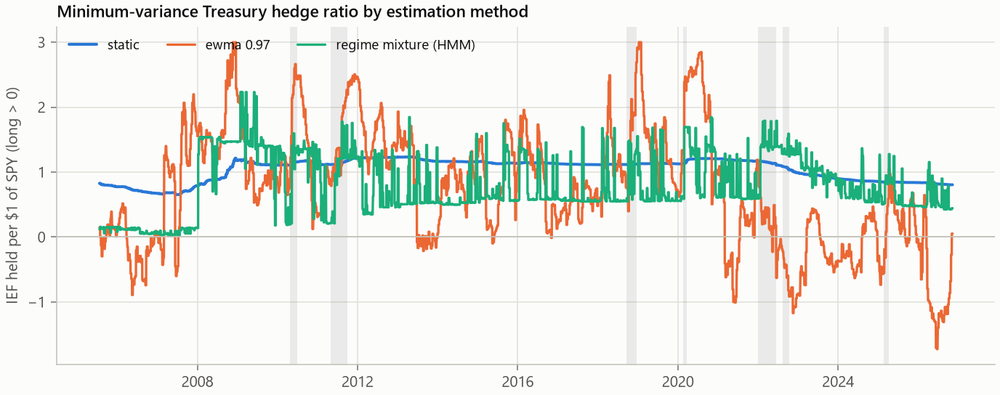

*Treasury hedge ratio over time.* Positive: long Treasuries against equities (a hedge when stocks and bonds are negatively correlated). Shading: bear markets.

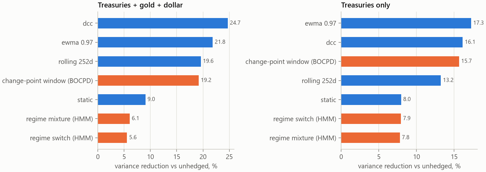

*Out-of-sample variance reduction by method.* Orange: methods that use regime detection (HMM or change points); blue: methods that do not.

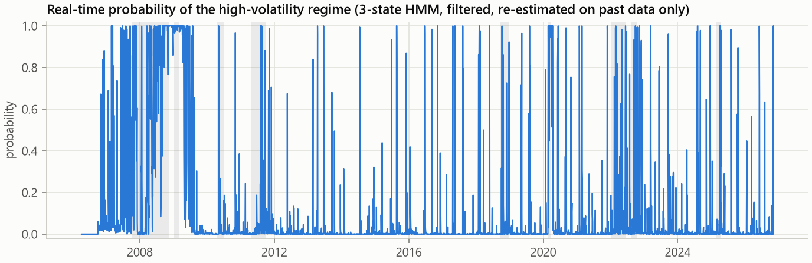

*Real-time crisis-regime probability.* The probability uses only information available on each day (parameters re-estimated every six months on past data). Shading: bear markets.

- **Regime-based vs adaptive hedges** [Predictive] Variance reduction (multi-hedge): static 9.0%, rolling 252d 19.6%, ewma 0.97 21.8%, dcc 24.7%, regime mixture (HMM) 6.1%, regime switch (HMM) 5.6%, change-point window (BOCPD) 19.2%.
  - One 16-year path; differences of a few points of variance reduction are within sampling noise.
  - HMM states are estimated on four features; other feature sets would give other regimes.
- **The 2022 test case** [Predictive] Cumulative return Jan-Oct 2022 with a Treasury hedge: unhedged -24.1%, static -38.0%, rolling 252d -27.1%, ewma 0.97 -27.3%, dcc -28.1%, regime mixture (HMM) -40.1%, regime switch (HMM) -39.7%, change-point window (BOCPD) -29.2%.
  - A single episode; it shows the mechanism (static hedges keep buying bonds as both fall), not a statistically general result.

### Hedging SPY with Treasuries, gold and the dollar (out of sample, 2010-2026)

|  | ann. vol (%) | variance reduction (%) | ES 5% daily (%) | max drawdown (%) | ann. return (%) | annual turnover | DM t vs rolling 252d | DM t vs static |
|---|---|---|---|---|---|---|---|---|
| unhedged | 17.06 | 0.00 | 2.59 | -33.72 | 14.67 | 0.00 |  |  |
| static | 16.27 | 9.05 | 2.41 | -35.58 | 19.39 | 0.18 | 3.36 |  |
| rolling 252d | 15.30 | 19.58 | 2.31 | -30.86 | 17.10 | 4.04 |  | -3.36 |
| ewma 0.97 | 15.08 | 21.83 | 2.28 | -39.81 | 16.85 | 15.20 | -1.07 | -4.28 |
| dcc | 14.80 | 24.72 | 2.22 | -33.05 | 18.04 | 22.08 | -2.39 | -5.52 |
| regime mixture (HMM) | 16.54 | 6.05 | 2.45 | -34.86 | 17.95 | 13.47 | 2.83 | 1.41 |
| regime switch (HMM) | 16.58 | 5.55 | 2.47 | -35.02 | 17.36 | 11.19 | 2.94 | 1.60 |
| change-point window (BOCPD) | 15.34 | 19.17 | 2.30 | -37.65 | 18.23 | 9.29 | 0.28 | -3.37 |

Weekly rebalancing, 2bp cost per unit of notional traded. DM t: Diebold-Mariano statistic on squared hedged returns; negative = lower variance than the comparison method.

### Hedging SPY with Treasuries only

|  | ann. vol (%) | variance reduction (%) | ES 5% daily (%) | max drawdown (%) | ann. return (%) | annual turnover | DM t vs rolling 252d | DM t vs static |
|---|---|---|---|---|---|---|---|---|
| unhedged | 19.05 | 0.00 | 2.92 | -55.19 | 12.15 | 0.00 |  |  |
| static | 18.27 | 7.96 | 2.71 | -45.79 | 15.35 | 0.12 | 3.42 |  |
| rolling 252d | 17.74 | 13.23 | 2.64 | -40.39 | 15.52 | 1.83 |  | -3.42 |
| ewma 0.97 | 17.33 | 17.25 | 2.55 | -38.30 | 16.70 | 6.94 | -4.07 | -4.76 |
| dcc | 17.44 | 16.13 | 2.56 | -39.03 | 16.82 | 17.65 | -2.01 | -3.61 |
| regime mixture (HMM) | 18.29 | 7.79 | 2.73 | -45.99 | 14.53 | 7.92 | 3.12 | 0.16 |
| regime switch (HMM) | 18.28 | 7.94 | 2.74 | -45.56 | 14.48 | 6.67 | 2.84 | -0.00 |
| change-point window (BOCPD) | 17.49 | 15.66 | 2.58 | -38.46 | 17.02 | 3.78 | -2.39 | -4.43 |

### Cumulative return in each sell-off (Treasuries + gold + dollar hedge), %

|  | unhedged | static | rolling 252d | ewma 0.97 | dcc | regime mixture (HMM) | regime switch (HMM) | change-point window (BOCPD) |
|---|---|---|---|---|---|---|---|---|
| 2010-04-23..2010-07-02 | -15.1 | -3.4 | -9.4 | -3.1 | -2.4 | -8.2 | -10.0 | -4.6 |
| 2011-04-29..2011-10-03 | -18.4 | 4.4 | -3.3 | 3.0 | 6.7 | 1.2 | -0.9 | -1.0 |
| 2015-07-20..2015-08-25 | -11.9 | -11.7 | -10.7 | -10.2 | -10.6 | -12.5 | -12.7 | -11.1 |
| 2015-11-03..2016-02-11 | -12.6 | -7.5 | -9.6 | -4.2 | -3.5 | -7.7 | -7.9 | -8.2 |
| 2018-01-26..2018-02-08 | -9.1 | -10.1 | -9.8 | -9.8 | -9.6 | -9.9 | -9.9 | -9.6 |
| 2018-09-20..2018-12-24 | -18.7 | -13.7 | -14.4 | -11.1 | -11.1 | -13.9 | -14.6 | -11.2 |
| 2020-02-19..2020-03-23 | -33.4 | -25.7 | -30.6 | -38.7 | -28.0 | -22.7 | -22.6 | -37.3 |
| 2022-01-03..2022-03-08 | -12.4 | -14.7 | -11.5 | -10.6 | -11.4 | -13.4 | -14.0 | -13.4 |
| 2022-03-29..2022-06-16 | -19.6 | -23.7 | -18.1 | -17.5 | -20.1 | -23.6 | -23.1 | -18.8 |
| 2022-08-16..2022-10-12 | -16.5 | -22.2 | -10.7 | -8.7 | -9.9 | -22.1 | -21.8 | -10.4 |
| 2025-02-19..2025-04-08 | -18.6 | -17.7 | -19.3 | -19.9 | -20.8 | -18.9 | -18.7 | -20.3 |
| 2022-01-03..2022-10-12 | -24.1 | -34.3 | -15.0 | -11.8 | -16.0 | -33.3 | -33.3 | -18.1 |

Sell-offs dated with the 10%/10% rule after the evaluation starts, plus the 2022 rate shock.

**Robustness**

- Hedge ratios are capped at 3x, rebalanced weekly and charged 2bp per unit of notional traded; other rebalancing frequencies and cost levels were not tested.
- The change-point window counts as regime detection (online Bayesian change points); it performs like a plain rolling window.
- Turnover (annual, multiples of notional): static 0.2, rolling 252d 4.0, ewma 0.97 15.2, dcc 22.1, regime mixture (HMM) 13.5, regime switch (HMM) 11.2, change-point window (BOCPD) 9.3.

## Method notes

### Common-factor structure (dynamic factor model)

|  | global factor R2 | global + block R2 | block |
|---|---|---|---|
| EFA | 0.96 | 0.97 | equity |
| SPY | 0.86 | 0.96 | equity |
| EEM | 0.84 | 0.87 | equity |
| IWM | 0.75 | 0.91 | equity |
| XLF | 0.68 | 0.79 | equity |
| VIX | 0.53 | 1.00 | volatility |
| COPPER_F | 0.24 | 0.96 | commodity |
| DXY | 0.20 | 0.83 | fx |
| OIL | 0.14 | 0.26 | commodity |
| BAA10Y | 0.13 | 0.13 | none (only series in its class) |
| MOVE | 0.08 | 0.15 | volatility |
| GOLD | 0.07 | 0.24 | commodity |
| UST10Y | 0.03 | 0.86 | rates |
| UST2Y | 0.03 | 0.86 | rates |
| USDJPY | 0.02 | 0.78 | fx |

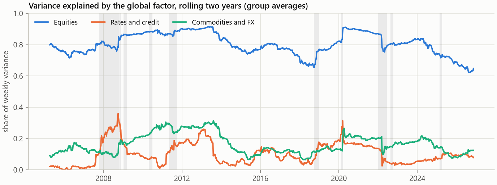

|  | NET | same-day part | lagged part |
|---|---|---|---|
| hub | +11.1 | +11.1 | -0.0 |
| a | -5.6 | -5.6 | -0.0 |
| b | -5.6 | -5.6 | +0.0 |

|  | NET | same-day part | lagged part |
|---|---|---|---|
| leader | +19.7 | -0.0 | +19.7 |
| follower | -19.7 | +0.0 | -19.7 |
